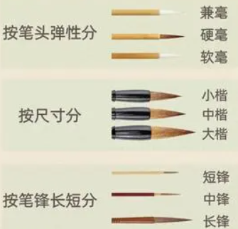
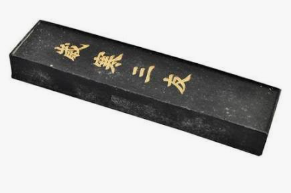
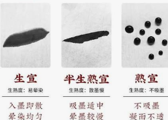
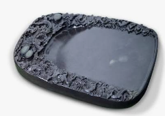
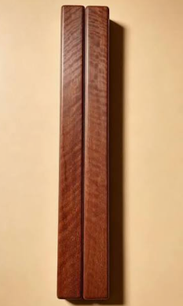
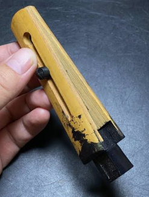
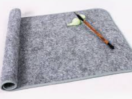

## learnForCalligraphy
学习书法，记住来时路。培养一门休息时用来放松的爱好

### 工具

| 毛笔 | 墨条 | 纸张 | 砚台 | 镇尺 | 墨夹 | 毛毡垫 |
| - | - | - | - | - | - | - |
|  |  |  |  |  |   |  |

### 纸张选取

字越小越求精细，用纸越熟；字越大越求气势，用纸越生

| 纸张类型 | 特点与工艺 | 墨水效果 | 品名 | 适用 |
| - | - | - | - | - |
| 生纸（生宣）| 未经过胶矾加工的原生态纸张，植物纤维裸露，吸水力强 | 能产生丰富的墨韵、枯笔与层次感 | 净皮、单宣、大行草书及写意山水画用纸 | 行书 / 草书 | 
| 熟纸（熟宣）| 生纸表面涂抹了胶矾，胶将明矾固定在纸面上，填补了纤维空隙| 纸质相对较硬，水墨只会停留在表面，线条清晰边缘平滑 | 蝉衣笺、玉版矾纸、工笔画及小楷用纸 | 小楷 |
| 半生半熟纸 | 吸水与渗透能力介于两者之间，工艺上控制了胶矾的比例 | 有轻微的墨色变化，又不会过度失控 | 元书纸、毛边纸、半熟宣 | 楷书 / 隶书 / 篆书|

### 篆书 Seal script

<table>
    <thead>
        <tr>
            <th>项目</th>
            <th>参考</th>
            <th>备注/笔记/理解</th>
        </tr>
    </thead>
    <tbody>
        <tr>
            <td colspan="3">主要参考学习：<a href="https://www.bilibili.com/video/BV1sN4y1U7Xf">陈忠建老师讲解的吴让之篆书</a>⭐⭐⭐⭐⭐   认识篆书参考：<a href="https://www.bilibili.com/video/BV1gU4y1J7zH/?spm_id_from=333.788.top_right_bar_window_custom_collection.content.click&vd_source=2d16dfcf663f73bc0693c3252ab95763">顾建平－篆书课程</a>⭐⭐⭐⭐⭐</td>
        </tr>
        <tr>
            <td colspan="3">毛笔：羊毫  纸张：宣纸(按照互联网术语降本增效：使用报纸)</td>
        </tr>
        <tr>
            <td>起笔</td>
            <td>1. <a href="https://www.bilibili.com/video/BV1sN4y1U7Xf/?spm_id_from=333.788.player.switch&vd_source=2d16dfcf663f73bc0693c3252ab95763">篆隶书方起笔和圆起笔✅发力细节和易错点</a> 2. <a href="https://www.bilibili.com/video/BV1C8SEBEEhY?spm_id_from=333.788.videopod.sections&vd_source=2d16dfcf663f73bc0693c3252ab95763"> 书法干货｜篆书、隶书、楷书 各种横画收笔怎么写～天津话解说</a></td>
            <td>
                (26.10.12始)主要学习逆锋、回锋，同时因为初学，所以练习中注意减少手抖，让线条看起来更加平稳。
                  1. 在练习时发现<u>横画</u>主要是移动肩关节，<u>竖画</u>需要移动肩关节和肘关节，使得手更容易抖，所以个人横竖练习比例4:6
                  2. 刷到很多人讨论笔法"切、顶、翻"，个人比较赞同：<a href="https://www.bilibili.com/video/BV1Hv4y1R7ux">崔寒柏老师谈笔法"切、顶、翻"</a>
                  3. 对于拉线条，个人试了兼毫和羊毫，，因为最开始买的毛笔是兼毫，练习回锋老是原地托马斯，然后果断买了只羊毫(26.10.15到货)，羊毫回锋/拉线条更舒适兼毫对于我这初学阶段还是太弹了
            </td>
        </tr>
        <tr>
            <td>收笔</td>
            <td><a href="https://www.bilibili.com/video/BV1C8SEBEEhY?spm_id_from=333.788.videopod.sections&vd_source=2d16dfcf663f73bc0693c3252ab95763">书法干货｜篆书、隶书、楷书 各种横画收笔怎么写～天津话解说</a></td>
            <td>主要练习圆收</td>
        </tr>
        <tr>
            <td>基本笔法</td>
            <td><a href="https://www.bilibili.com/video/BV1sN4y1U7Xf/?spm_id_from=333.788.player.switch&vd_source=2d16dfcf663f73bc0693c3252ab95763">陈忠建-02篆書基本筆法</a></td>
            <td>
                (26.10.16始) 自己下笔了就可以感受到陈忠建老师拉线条，开头和结尾一样大小长短（大概比了下，差不多都是1/5总长），同时线条的弯曲程度就像一个身材线条恰到好处的美女。自己拉线条有时候拉太长导致看起来像排骨战士，或者弯曲程度像是摆着僵硬pose的模特。
                  1. 陈忠建老师建议拉线条圆收时，需要稍微让毛笔多“溜”出来一点，出现由细到粗再到细的感觉（个人练习时也觉得这种处理更好看）。
                  2. 吴让之篆书的横，带着弧形，但是中间细又让横变“直”了
                  3. 不要动手腕，不要动手腕，不要动手腕，会然线条结尾比开头粗大好多！
            </td>
        </tr>
        <tr>
            <td>接笔</td>
            <td><a href="https://www.bilibili.com/video/BV1RC4y177jD?spm_id_from=333.788.player.switch&vd_source=2d16dfcf663f73bc0693c3252ab95763">陈忠建-03接筆方法</a></td>
            <td>1. 看陈忠建老师临摹，可以看到有时逆锋起笔并不需要完全藏起来，就像是简单的起“势”。</td>
        </tr>
    </tbody>
</table>

### 隶书 clerical script

### 行书 Running script

### 楷书 regular script

#### Reference

1. 《中国书法通识》方建勋